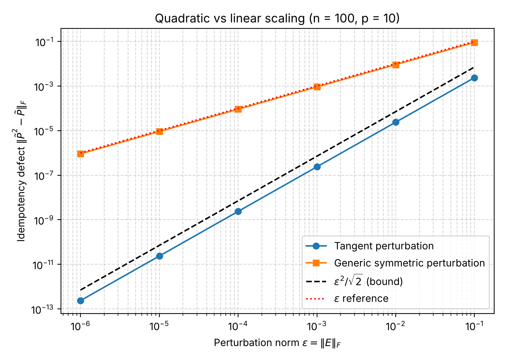
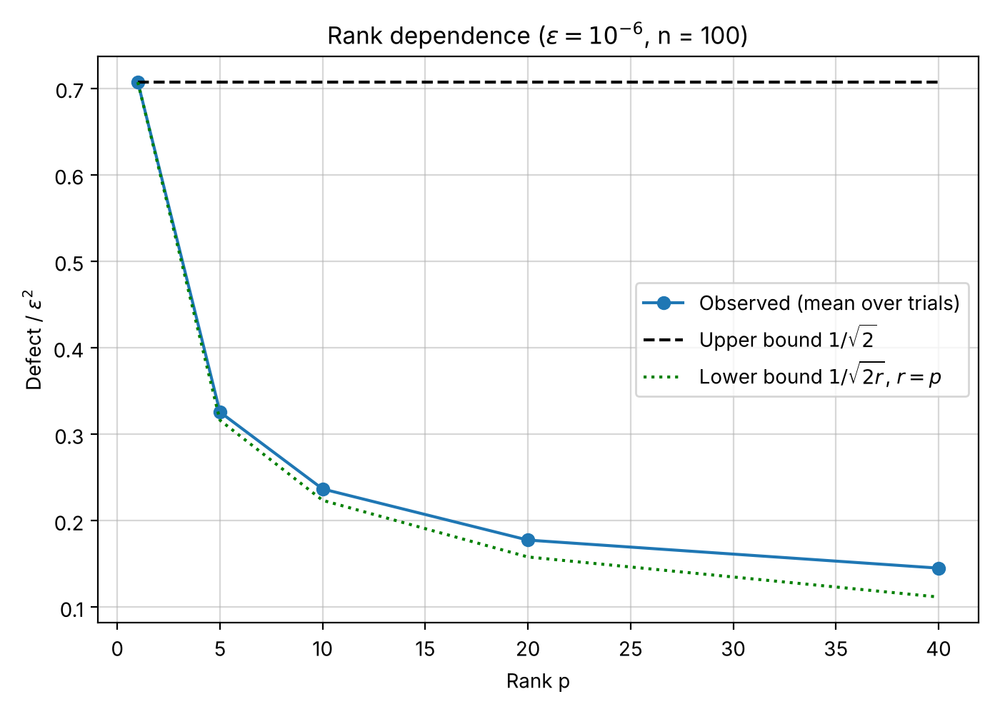

# Quadratic perturbation bounds for orthogonal projectors on the Grassmann manifold

Code for the numerical experiments in

> P. Kubwimana, B. Prabhakar Reddy, J. M. Mkenyeleye.
> *Lazy projection retraction for Grassmann optimization via sharp quadratic perturbation bounds.*
> Manuscript under review, 2026.

**Contact:** Pascal Kubwimana, Department of Mathematics and Statistics, University of Dodoma — kubwimanap4@gmail.com

## What the experiments show

Let `P` be a rank-`p` orthogonal projector and `E` a symmetric perturbation with `‖E‖_F = ε`.
If `E` is **tangent** to the Grassmann manifold at `P`, i.e. `E = PΔ(I−P) + (I−P)ΔᵀP`, then

- `P̃² − P̃ = E²` exactly, where `P̃ = P + E`, so the first-order term cancels;
- `‖P̃² − P̃‖_F ≤ ε²/√2`, with equality when the reduced perturbation has rank one;
- `‖P̃² − P̃‖_F ≥ ε²/√(2r)` when the reduced perturbation has rank `r`.

A generic symmetric perturbation of the same norm gives a defect of order `ε`.

## Results (seed 0, 30 trials per point)

**Residual scaling** (`n = 100`, `p = 10`)

| ε | Tangent defect | Defect / ε² | Generic defect | Defect / ε |
|---|---|---|---|---|
| 1e-6 | 2.373e-13 | 0.237 | 9.060e-07 | 0.906 |
| 1e-5 | 2.358e-11 | 0.236 | 9.072e-06 | 0.907 |
| 1e-4 | 2.363e-09 | 0.236 | 9.062e-05 | 0.906 |
| 1e-3 | 2.367e-07 | 0.237 | 9.059e-04 | 0.906 |
| 1e-2 | 2.373e-05 | 0.237 | 9.063e-03 | 0.906 |
| 1e-1 | 2.363e-03 | 0.236 | 9.062e-02 | 0.906 |

At ε = 10⁻⁶ the tangent defect is about 3.8 × 10⁶ times smaller than the generic one.



**Rank dependence** (`n = 100`, `ε = 10⁻⁶`)

| Rank p | Defect / ε² | Upper bound 1/√2 | Lower bound 1/√(2p) |
|---|---|---|---|
| 1 | 0.707 | 0.707 | 0.707 |
| 5 | 0.326 | 0.707 | 0.316 |
| 10 | 0.237 | 0.707 | 0.224 |
| 20 | 0.178 | 0.707 | 0.158 |
| 40 | 0.145 | 0.707 | 0.112 |

For a random tangent perturbation the reduced block has rank `r = min(p, n−p)`, so the observed ratio lies between the two bounds and equals the upper bound for `p = 1`.



## How to reproduce

Requires Python 3.9 or later.

```bash
pip install -r python/requirements.txt
python python/experiments.py            # synthetic experiments (about 1 minute)
python python/experiments.py --cifar    # also the CIFAR-10 check (downloads data from OpenML)
```

The script fixes the random seed, prints the tables above and writes CSV files and figures to `results/`.

The optional CIFAR-10 check builds a rank-10 PCA projector from 8,000 grayscale CIFAR-10 images (`n = 1024`) and repeats the tangent test around it. Since the defect equals `‖E²‖_F`, it depends on the perturbation and not on which projector is chosen; the check confirms that the identity holds numerically for a data-derived projector. The script stops with an error if the data cannot be downloaded.

MATLAB versions are in `matlab/`:

- `tangent_residual_check.m` — the residual-scaling test above;
- `basis_perturbation_check.m` — perturbs the basis and re-orthonormalises; the result is an exact projector, so the defect stays at rounding level.

## Repository layout

```
python/
  projector_utils.py   projectors, tangent and generic perturbations, defect, backward error
  experiments.py       runs all experiments and writes results/
  requirements.txt
matlab/
  tangent_residual_check.m
  basis_perturbation_check.m
results/               CSV tables and figures produced by experiments.py
```

## License

MIT — see [LICENSE](LICENSE).
