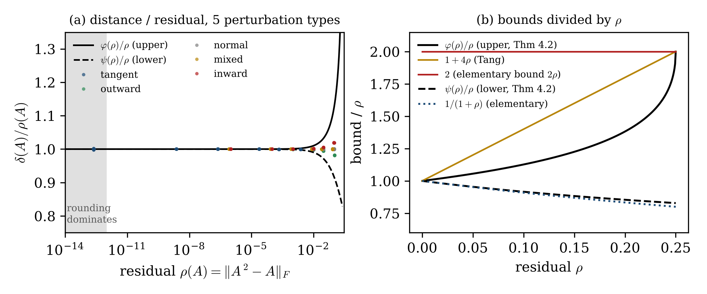

# Sharp residual certificates for projector iterates on the Grassmann manifold

Code, data and results for the revised manuscript

> P. Kubwimana, B. Prabhakar Reddy, J. M. Mkenyeleye. *Sharp residual certificates for projector iterates on the Grassmann manifold under numerical perturbations.* Manuscript, 2026.

This folder supersedes the experiments in `../python/` (preprint version, Research Square [10.21203/rs.3.rs-10428281/v1](https://doi.org/10.21203/rs.3.rs-10428281/v1)), which are kept unchanged for reference.

## Main result

For every symmetric matrix `A` with residual `ρ = ‖A² − A‖_F < 1/4`, the Frobenius distance `δ(A)` to the nearest orthogonal projector satisfies

```
ψ(ρ) = 2ρ / (1 + √(1 + 4ρ))  ≤  δ(A)  ≤  2ρ / (1 + √(1 − 4ρ)) = φ(ρ),
```

both bounds being attained (Theorem 4.2). Tangent perturbations of a projector attain the lower bound eigenvalue-wise; the normal component of a general perturbation equals the distance to first order; orthonormality drift `‖XᵀX − I‖_F` equals `δ(XXᵀ)`.

## Results (30 seeds, mean ± sd)

**Equality cases** (Table 1; `n = 100`, `p = 10`)

| Case | Prediction | Observed |
|---|---|---|
| Rank-one Δ, ε = 1e-2 | 0.7071 | 0.7071 ± 1e-12 |
| Equal singular values, ε = 1e-2 | 0.2236 | 0.2236 ± 2e-12 |
| One inward eigenvalue, δ/φ(ρ) | 1 | 1.000000 |
| One outward eigenvalue, δ/ψ(ρ) | 1 | 1.000000 |

**Certificate across perturbation types** (Table 4; `n = 100`, `p = 10`, means; all trials valid)

| Type | ε | δ/ψ(ρ) | δ/φ(ρ) | δ/(2ρ) |
|---|---|---|---|---|
| tangent | 0.1 | 1.0017 | 0.9970 | 0.500 |
| tangent | 0.01 | 1.0000 | 1.0000 | 0.500 |
| outward | 0.1 | 1.0731 | 0.8687 | 0.491 |
| outward | 0.01 | 1.0080 | 0.9880 | 0.499 |
| normal | 0.1 | 1.0916 | 0.8873 | 0.500 |
| normal | 0.01 | 1.0099 | 0.9899 | 0.500 |
| mixed | 0.1 | 1.0773 | 0.9082 | 0.500 |
| mixed | 0.01 | 1.0083 | 0.9916 | 0.500 |
| inward | 0.1 | 1.1107 | 0.9066 | 0.509 |
| inward | 0.01 | 1.0118 | 0.9918 | 0.501 |

**Projectors computed by practical routines** (Table 6)

| Problem | Routine | δ (exact) | certified bound φ(ρ₊) | subspace error |
|---|---|---|---|---|
| digits (p=5) | eigh64 | 2.7e-15 | 3.8e-14 | 1.7e-15 |
| digits (p=5) | eigh32 | 3.8e-08 | 3.8e-08 | 6.5e-08 |
| digits (p=5) | store16 | 3.1e-04 | 3.1e-04 | 4.3e-04 |
| digits (p=5) | cgs_power | 2.1e-12 | 2.1e-12 | 6.2e-14 |
| digits (p=10) | eigh64 | 3.9e-15 | 7.5e-14 | 2.6e-15 |
| digits (p=10) | eigh32 | 6.8e-08 | 6.8e-08 | 1.1e-07 |
| digits (p=10) | store16 | 5.6e-04 | 5.6e-04 | 5.5e-04 |
| digits (p=10) | cgs_power | 1.4e-07 | 1.4e-07 | 4.8e-12 |
| synthetic (p=10) | eigh64 | 4.3e-15 | 5.6e-13 | 2.7e-15 |
| synthetic (p=10) | eigh32 | 1.9e-08 | 1.9e-08 | 1.2e-07 |
| synthetic (p=10) | store16 | 1.5e-04 | 1.5e-04 | 6.5e-04 |
| synthetic (p=10) | cgs_power | 6.2e-14 | 6.2e-13 | 4.7e-15 |

**Benchmark suite** (Table 2; 30 seeds; B1 = synthetic Gr(100,10), B2′ = UCI digits covariance)

| Problem | Precision | Policy | Final dist | Iterations | Eigendecompositions | Divergences |
|---|---|---|---|---|---|---|
| B1 | float64 | always + shift | 6.15e-10 | 379.3 | 379.3 | 0 |
| B1 | float64 | apriori + shift | 6.15e-10 | 379.3 | 173.9 | 0 |
| B1 | float64 | certified + shift | 6.15e-10 | 379.3 | 172.9 | 0 |
| B1 | float64 | certified, no shift | 6.00e-10 | 379.7 | 188.8 | 0 |
| B1 | float64 | certified, τ = 0 | 6.15e-10 | 379.3 | 379.3 | 0 |
| B1 | float32 | always + shift | 5.93e-05 | 182.4 | 182.4 | 0 |
| B1 | float32 | apriori + shift | 5.92e-05 | 182.4 | 57.2 | 0 |
| B1 | float32 | certified + shift | 5.93e-05 | 182.4 | 58.9 | 0 |
| B1 | float32 | certified, no shift | 5.03e-05 | 185.4 | 72.9 | 0 |
| B2 | float64 | always + shift | 1.45e-09 | 428.9 | 428.9 | 0 |
| B2 | float64 | apriori + shift | 1.45e-09 | 428.9 | 199.4 | 0 |
| B2 | float64 | certified + shift | 1.45e-09 | 428.9 | 198.2 | 0 |
| B2 | float64 | certified, no shift | 1.45e-09 | 428.9 | 206.8 | 0 |
| B2 | float64 | certified, τ = 0 | 1.45e-09 | 428.9 | 428.9 | 0 |
| B2 | float32 | always + shift | 1.41e-04 | 195.4 | 195.4 | 0 |
| B2 | float32 | apriori + shift | 1.41e-04 | 195.4 | 62.9 | 0 |
| B2 | float32 | certified + shift | 1.41e-04 | 195.4 | 63.2 | 0 |
| B2 | float32 | certified, no shift | 1.28e-04 | 197.7 | 70.4 | 0 |

**Sensitivity of Algorithm 1** (Table 3; B1, double, certified + shift)

| Factor | Value | Iterations | Eigendecompositions saved | Divergences |
|---|---|---|---|---|
| step | 0.25 | 1527.7 | 61% | 0 |
| step | 0.5 | 761.3 | 58% | 0 |
| step | 1 | 379.3 | 55% | 0 |
| step | 1.5 | 249.9 | 53% | 0 |
| step | 2 | 4999.0 | 0% | 30 |
| tau | 1e-14 | 379.3 | 0% | 0 |
| tau | 1e-12 | 379.3 | 44% | 0 |
| tau | 1e-10 | 379.3 | 55% | 0 |
| tau | 1e-08 | 379.3 | 65% | 0 |
| tau | 1e-06 | 379.3 | 75% | 0 |

**Certified lazy re-projection** (Table 7; τ = 1e-10)

| Problem | Policy | Iterations | Eigendecompositions | max δ(P_k) |
|---|---|---|---|---|
| syn_300_0.5 | always + shift | 88.2 | 88.2 | 1.01e-14 |
| syn_300_0.5 | apriori + shift | 88.2 | 48.1 | 9.83e-11 |
| syn_300_0.5 | certified + shift | 88.2 | 47.4 | 9.91e-11 |
| syn_300_0.5 | apriori, no shift | 98.0 | 49.6 | 2.01e-05 |
| syn_300_0.5 | certified, no shift | 88.3 | 51.1 | 9.96e-11 |
| syn_300_0.1 | always + shift | 415.2 | 415.2 | 8.01e-15 |
| syn_300_0.1 | apriori + shift | 415.2 | 195.9 | 9.97e-11 |
| syn_300_0.1 | certified + shift | 415.2 | 195.0 | 9.96e-11 |
| syn_300_0.1 | apriori, no shift | 421.5 | 201.9 | 2.09e-05 |
| syn_300_0.1 | certified, no shift | 415.5 | 212.1 | 9.96e-11 |
| digits_5 | always + shift | 347.3 | 347.3 | 4.10e-15 |
| digits_5 | apriori + shift | 347.3 | 158.5 | 9.99e-11 |
| digits_5 | certified + shift | 347.3 | 157.5 | 9.99e-11 |
| digits_5 | apriori, no shift | 347.3 | 162.5 | 2.38e-05 |
| digits_5 | certified, no shift | 347.4 | 169.4 | 9.99e-11 |
| digits_10 | always + shift | 423.2 | 423.2 | 6.47e-15 |
| digits_10 | apriori + shift | 423.2 | 196.5 | 9.96e-11 |
| digits_10 | certified + shift | 423.2 | 195.3 | 9.99e-11 |
| digits_10 | apriori, no shift | 444.5 | 199.4 | 3.22e-05 |
| digits_10 | certified, no shift | 423.3 | 203.9 | 9.98e-11 |

**Wall-clock time** (Table 8; `n = 1000`, 5 seeds, two-core machine)

| Problem | Policy | Eigendecompositions | Time (s) |
|---|---|---|---|
| syn_1000_0.5 | always | 88.8 | 23.8 ± 0.8 |
| syn_1000_0.5 | apriori | 48.4 | 17.7 ± 0.8 |
| syn_1000_0.5 | certified | 48.0 | 20.9 ± 0.7 |
| syn_1000_0.1 | always | 431.2 | 116.5 ± 4.4 |
| syn_1000_0.1 | apriori | 204.4 | 79.2 ± 4.4 |
| syn_1000_0.1 | certified | 203.6 | 93.3 ± 3.8 |




## Revision after referee report (November 2026)

* `exps.py`: the certified test (`cert_skip`) now includes the rounding of both norms and of the scalar operations (Proposition 4.8) and the rank guard of Lemma 5.1; `bench`, `sens_alg` and `trace` were re-run with it. `lazy_counts.json` and `lazy_time.json` are kept from the previous version and are superseded by `baselines.json` and `time2.json`.
* `exps2.py` (new): `baselines` (always, certified, a priori, every 10th step, McWeeny purification, certified + purification, with and without shift; work counted in matrix products, an eigendecomposition = 4.5), `time2` (n = 1000, median and IQR, including a frame-based QR retraction), `shift` (Lemma 5.3, predicted vs observed defect growth), `accuracy` (Theorem 5.4, contraction factor and bound).
* `supplementary_tables.pdf`: Tables S1-S4 of the revised manuscript.

Key findings: the certified test removes 47-55% of eigendecompositions and 17-22% of the work while every iterate stays within tau; re-projecting every 10th step (48%) or purifying every step (23%) needs less work but lets iterates move to distance up to 5.2 and 0.15 from the manifold; a frame-based method is about 150x faster at n = 1000 when only the subspace is needed. The shift lemma predicts the observed defect growth within 6%.

## How to reproduce

Requires Python 3.9+ (`pip install -r requirements.txt`).

```bash
cd certificate
python exps.py sharp        # Table 1 (known cases)
python exps.py cert         # Fig. 1, Table S2
python exps.py sens         # Table S1 (dimension sensitivity)
python exps.py floor        # rounding floor
python exps.py computed     # Table S3 (computed projectors)
python exps.py bench        # Table 3 (Syn-100, Digits-64, double and single)
python exps.py sens_alg     # Table S1 (step size and tolerance)
python exps.py trace        # Fig. 2
python exps2.py shift       # Table 2, Lemma 5.3
python exps2.py accuracy    # Table 2, Theorem 5.4
python exps2.py baselines   # Table 4, Table S4
python exps2.py time2 --seeds 10   # Table 5 (run alone; about 1 hour)
python figures.py           # Figures 1-2
```

or `./run_all.sh`. All randomness is seeded; timings depend on the machine.

## Note on the CIFAR-10 check of the preprint

For rotation-invariant tangent perturbations the projector-level statistics are the same at every rank-`p` projector, so the CIFAR-10 check in `../python/experiments.py --cifar` reproduces the constant `√(n/(2p(n−p)))` and gives no information about the data. In the revised paper real data enter only through how a projector is computed (experiment `computed`).
